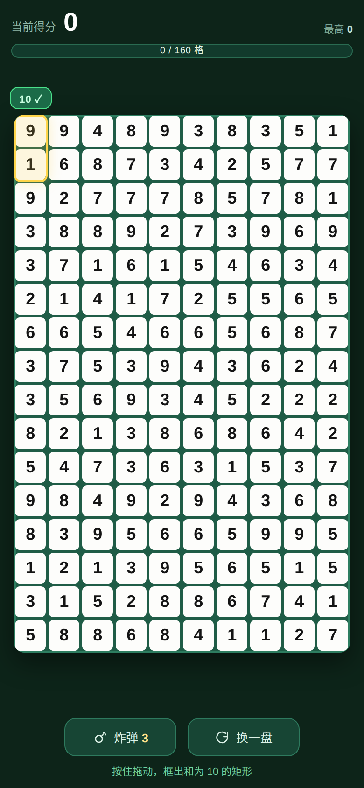

# 凑十消除

框出**和等于 10** 的矩形，把整盘数字消干净。

<p align="center">
  
</p>

同一套核心逻辑，三个端：

| 端 | 目录 | 说明 |
|---|---|---|
| Web / PWA | `www/` | 浏览器直接玩，也可「添加到主屏幕」 |
| iOS App | `www/` + Capacitor | GitHub Actions 自动产出未签名 ipa |
| 微信小程序 | `miniprogram/` | 微信开发者工具导入即用 |

## 玩法

- 盘面 **16 行 × 10 列**，每格是 1–9 的随机数字。
- 按住拖出一个矩形，**框内剩余数字之和 = 10** 就能消除。
- 消除后格子留空，**其他数字位置完全不动**；选框可以跨过空格，只对框里剩下的数字求和。
- **得分 = 消除的数字个数**，全清满分 160。
- 每次开局送 **3 个炸弹**，点一下自动清掉一组，不额外加分。
- 消到框不出 10 时结算，最高分存在本地。

生成盘面时会把 160 格的总和调成 10 的倍数（`balanceTotal()`），所以理论上存在清空的可能；实际能不能清完取决于布局。

## 目录结构

```
.
├── www/                     # Web 游戏（也是 Capacitor 的 webDir）
│   ├── index.html
│   ├── style.css
│   ├── game.js              # 全部游戏逻辑
│   ├── manifest.webmanifest
│   ├── sw.js                # PWA 离线缓存
│   └── icons/
├── miniprogram/             # 微信小程序工程
├── assets/icon-1024.png     # App 图标源图
├── scripts/make-icons.py    # 生成各尺寸图标
├── capacitor.config.json
├── package.json
└── .github/workflows/build-ipa.yml
```

## 本地运行

### 1. 浏览器

```bash
npm install
npm run serve          # http://localhost:8080
```

也可以直接双击 `www/index.html`（PWA 离线缓存只在 http 下生效）。

### 2. 微信小程序

微信开发者工具 → 导入项目 → 选择 `miniprogram/` 目录 → AppID 填自己的（或点「测试号」）→ 编译。

### 3. iOS（需要 macOS + Xcode）

```bash
npm install
npx cap add ios
npx cap sync ios
npx cap open ios        # 在 Xcode 里选真机运行
```

## 生成 ipa

仓库自带 GitHub Actions 工作流 `.github/workflows/build-ipa.yml`：push 到 `main` 或手动 `workflow_dispatch`，会在 `macos-14` 上：

1. `npx cap add ios` 生成 iOS 工程并 `pod install`
2. 替换 App 图标、锁定竖屏、写入中文显示名
3. `xcodebuild` 以 **关闭签名** 的方式编译 Release
4. 打包 `Payload/App.app` 成 `sumten-unsigned.ipa`
5. 上传为构建产物（Actions 页面底部下载）

**这个 ipa 没有签名，不能直接双击安装**，要用自签工具重签后再装：

| 工具 | 平台 | 说明 |
|---|---|---|
| Sideloadly | Win / macOS | 填 Apple ID 免费签名，7 天有效 |
| AltStore | Win / macOS | 同上，可自动续签 |
| 爱思助手 | Windows | 「IPA 签名」功能 |
| TrollStore | 越狱/部分系统 | 免签名直接安装 |

想产出**正式签名**的 ipa，需要把自己的证书放进仓库 Secrets（`BUILD_CERTIFICATE_BASE64`、`P12_PASSWORD`、`PROVISIONING_PROFILE_BASE64`、`KEYCHAIN_PASSWORD`），再把工作流里的 `CODE_SIGNING_ALLOWED=NO` 换成 `-exportArchive` + `ExportOptions.plist`，这里不预置以避免证书泄露。

## 常见改动

| 想改什么 | 改哪里 |
|---|---|
| 网格大小 | `www/game.js` 顶部 `ROWS` / `COLS`（小程序同步改 `pages/index/index.js`） |
| 目标数字 | `findRect()` 里的 `=== 10`，以及 `balanceTotal()` 的 `% 10` |
| 得分规则 | `clearRect()` 里 `score += n`，改成 `score += 10` 就是每组固定 10 分 |
| 炸弹数量 | `BOMB_INIT` |
| 配色 | `www/style.css` 顶部 CSS 变量；小程序改 `index.wxss` |
| App 名称 / 包名 | `capacitor.config.json` 的 `appName` / `appId` |

## 已知限制

- 纯随机盘面 + 矩形约束，实际一局通常能消 80–120 格，很难 160 全清；这是玩法本身的数学性质，不是 bug。
- 未签名 ipa 无法直接安装，必须自签。
- 小程序端未做云开发排行榜，最高分只存本地。
